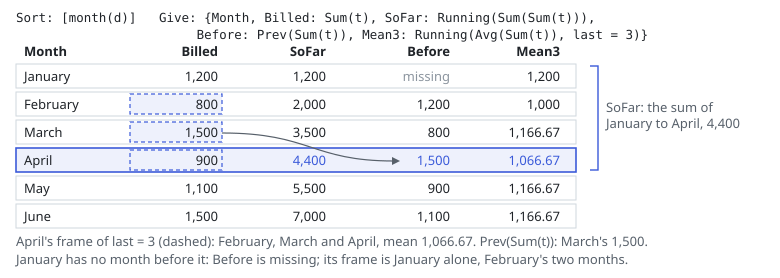
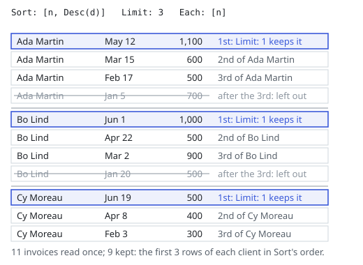
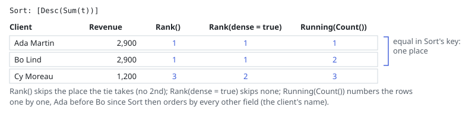

# Tutorials: business problems solved step by step, PostgreSQL beside

Each tutorial takes one problem that business software meets every day, and solves it with Cepheus step by step: the
problem, the Cepheus solution, what PostgreSQL writes for the same thing, and the difference, measured or guaranteed.
The words are explained where they first appear, and in the [glossary](glossary.md); every call is described exactly
in [Cepheus from Cesia](cesia.md).

**How to read the code.** The Cesia blocks run as written, against a real server, each time the tests run
(`test/cesia.sh`): each block runs with every block before it, as one program, and what follows it is what it printed.
So the tutorials share one database, as the parts of one application do. The SQL is PostgreSQL 18.6, run with `psql`
on the same tables holding the same rows; what follows it is what PostgreSQL answered.

## The tutorials' database

Clients and their invoices, the data every tutorial uses. A **kind** groups the properties of a sort of thing; a
**thing** is a number, its id; a property of `many` values holds a list (a client's phones); `Closed` is a flag that a
closed account has; `Link(to = "client")` links an invoice to a thing that must be a client, SQL's foreign key
([tutorial 10](#10-a-client-with-invoices-cannot-be-deleted-an-invoices-lines-go-with-it)).

```cesia norun
use deps/www-celestial/cepheus/cesia/cepheus
use std/date
use std/fiber
use std/io
use std/list
use std/math
use std/result
use std/sys
use std/text
use std/value

Client = cepheus.Kind("client", {Name: cepheus.Text(), City: cepheus.Text(), Phone: cepheus.Text(many = true), Closed: cepheus.Bool()})
Invoice = cepheus.Kind("invoice", {
  Client: cepheus.Link(to = "client"), Number: cepheus.Int(unique = true), Total: cepheus.Money(2), Status: cepheus.Text(),
  Date: cepheus.Date(), Due: cepheus.Date(), PaidAt: cepheus.Date(),
})

defn connect(kinds)
  (** The tutorials' database, with these kinds declared in it: its address and its token from the environment. *)
  result.Unwrap(cepheus.Connect(sys.Env("CEPHEUS_URL"), kinds, token = sys.Env("CEPHEUS_TOKEN")))
end

db = connect([Client, Invoice])
ada = result.Unwrap(cepheus.Insert(Client, {Name: "Ada Martin", City: "Lyon", Phone: ["04 00 00 00 01", "06 00 00 00 01"]}, db))
bo = result.Unwrap(cepheus.Insert(Client, {Name: "Bo Lind", City: "Paris", Phone: ["01 00 00 00 02"]}, db))
cy = result.Unwrap(cepheus.Insert(Client, {Name: "Cy Moreau", City: "Nice"}, db))
di = result.Unwrap(cepheus.Insert(Client, {Name: "Di Weber", City: "Lyon", Closed: true}, db))
io.Print(ada, bo, cy, di)
```

```text
65536 65537 65538 65539
```

The same tables in PostgreSQL, as a PostgreSQL user writes them (a client's phones in a table of their own, since a
client may have several):

```sql
CREATE TABLE client (id bigint GENERATED ALWAYS AS IDENTITY PRIMARY KEY, name text NOT NULL, city text NOT NULL,
                     closed bool NOT NULL DEFAULT false);
CREATE TABLE phone (client bigint NOT NULL REFERENCES client, number text NOT NULL);
CREATE TABLE invoice (id bigint GENERATED ALWAYS AS IDENTITY PRIMARY KEY, client bigint NOT NULL REFERENCES client,
                      number bigint UNIQUE, total numeric(12,2) NOT NULL, status text NOT NULL,
                      date timestamptz NOT NULL, due timestamptz, paid_at timestamptz);
```

## 1. Invoice numbers with no gap

**The problem.** An invoice carries "a sequential number, based on one or more series, which uniquely identifies the
invoice" (the European VAT directive, 2006/112/EC, article 226), and the tax offices of several countries, France
among them, read it as a sequence with no gap: a missing number must be explained. Many clerks and programs bill at
the same time, and some invoices are refused on the way (a closed account, a check that fails): a refused invoice must
take no number.

**The Cepheus solution.** A **counter**, a thing with an `Int` property, that the group making the invoice increments
with `cepheus.Incr`: the database reads the counter when it applies the group, and `into` writes the new value as the
invoice's number, in the same group. A **group** is a write of several facts, all or nothing: refused, it writes
nothing, so it takes no number.

```cesia norun
Counter = cepheus.Kind("counter", {Last: cepheus.Int()})
db = connect([Client, Invoice, Counter])
numbers = result.Unwrap(cepheus.Insert(Counter, {Last: 0}, db))

defn bill(client, total, at, db)
  (** An invoice of this client, numbered in the group that makes it: refused whole, taking no number, when the
      client's account is closed. *)
  cepheus.Write([
    cepheus.Expect(client, Client.Closed),
    cepheus.Incr(numbers, Counter.Last, into = [cepheus.New(1), Invoice.Number]),
    cepheus.Add(cepheus.New(1), Invoice.Client, client),
    cepheus.Add(cepheus.New(1), Invoice.Total, total),
    cepheus.Add(cepheus.New(1), Invoice.Date, at),
    cepheus.Add(cepheus.New(1), Invoice.Status, "unpaid")
  ], db)
end
```

Step by step: `Expect(client, Client.Closed)` holds only if the client has no `Closed` fact (Di has one); `Incr`
counts one more; `New(1)` is the thing the group makes, the invoice, which gets the number. Now 30 invoices at the
same time, one **fiber** each (one of Cesia's light threads), a third of them for Di:

```cesia norun
who = [ada, bo, di]
when = [1772409600, 1748822400, 1772409600]
tasks = [fiber.Spawn(() -> bill(who[1 + math.Mod(k, 3)], 10 * k, when[1 + math.Mod(k, 3)], db)) for k in 1..30]
outcomes = [result.Unwrap(fiber.Wait(t)) for t in tasks]
io.Print("written:", list.Count(result.IsOk, outcomes), "refused:", list.Count(result.IsErr, outcomes))
got = result.Unwrap(cepheus.Find(2, (i, n) -> {Where: [[i, Invoice.Number, n]], Give: {Number: n}, Sort: [n]}, db))
io.Print([r.Number for r in got])
io.Print(cepheus.Get(Counter, numbers, db))
```

```text
written: 20 refused: 10
[1, 2, 3, 4, 5, 6, 7, 8, 9, 10, 11, 12, 13, 14, 15, 16, 17, 18, 19, 20]
Ok({Last: 20})
```

(Ada's invoices are dated 2 March 2026, Bo's 2 June 2025: `when` gives seconds since 1970, as `sys.Now()` does.) The
20 invoices written hold the numbers 1 to 20, whatever order the fibers ran in, and the 10 refused took none.

**PostgreSQL** gives numbers with a **sequence**, `nextval`, which never goes back: a transaction that takes a number
and is then rolled back leaves a gap. The same 20 invoices took the numbers 1 to 20 from it; then:

```sql
CREATE SEQUENCE invoice_number;
BEGIN;
INSERT INTO invoice (client, number, total, status, date) VALUES (1, nextval('invoice_number'), 10, 'unpaid', now());
ROLLBACK;
INSERT INTO invoice (client, number, total, status, date)
  VALUES (1, nextval('invoice_number'), 20, 'unpaid', now()) RETURNING number;
```

```text
 number
--------
     22
```

Number 21 went with the transaction rolled back. This is by design: PostgreSQL's documentation says that a value
`nextval` gave is not taken back when its transaction aborts, so that transactions numbering at the same time never
wait for each other, and that aborts and crashes therefore leave gaps ([Sequence Manipulation
Functions](https://www.postgresql.org/docs/18/functions-sequence.html)). The way without a gap in PostgreSQL is a
counter row that each invoice's transaction updates:

```sql
CREATE TABLE counter (id int PRIMARY KEY, last bigint NOT NULL);
-- the counter row stays locked until the transaction ends
WITH n AS (UPDATE counter SET last = last + 1 WHERE id = 1 RETURNING last)
INSERT INTO invoice (client, number, total, status, date) SELECT 1, last, 30, 'unpaid', now() FROM n;
```

**The difference.** Both give no gap that way; the cost differs. PostgreSQL's `UPDATE` locks the counter row until
the transaction ends, and a transaction ends after its commit is on the disk (an fsync): every invoice waits for the
one before it to be written, so invoices are made one fsync at a time, whatever the number of clerks. Cepheus takes no
lock: its one writer applies the groups in order, reading the counter at each, and the groups that arrive while the
disk works share the next fsync (group commit), so 30 clerks wait for about one fsync together, not 30 one after the
other. Measured with 64 writers on one counter: Cepheus 5,890 writes a second, PostgreSQL 154 ([what it
costs](#what-it-costs)).

## 2. A job queue where each job is taken once

**The problem.** Work to do later is put in a queue: send a reminder, make a PDF, call a bank. Several workers take the
jobs, at the same time; each job must be done once, never by two workers, and a worker that stops in the middle of a
job (a crash, a deployment) must not lose it.

**The Cepheus solution.** A job is a thing with a `State`. A worker takes a job by a group that holds only if the job
is still queued (`Expect`), and marks it taken in the same group: of two workers that try the same job, the second's
group is refused with Code `"conflict"`, and that worker takes another. Nothing is locked: the refusal is the answer
of the same round trip.

```cesia norun
Job = cepheus.Kind("job", {Task: cepheus.Text(), State: cepheus.Text(), Worker: cepheus.Int(), Since: cepheus.Date()})
db = connect([Client, Invoice, Counter, Job])
for k in 1..40
  result.Unwrap(cepheus.Insert(Job, {Task: "send reminder $k", State: "queued"}, db))
end

defn take(w, db)
  (** Worker w takes one of the four oldest queued jobs (each worker aims at another one): an Ok of its id, an Ok of
      missing when none is queued, or the write's Err; a job another worker took first is a conflict, and w looks
      again. *)
  while true
    next = cepheus.Find(1, (j) -> {Where: [[j, Job.State, "queued"]], Give: {Job: j}, Sort: [j], Limit: 4}, db)?
    return result.Ok(missing) if value.Len(next) == 0
    j = next[1 + math.Mod(w, value.Len(next))].Job
    taken = cepheus.Write([
      cepheus.Expect(j, Job.State, "queued"),
      cepheus.Add(j, Job.State, "taken"), cepheus.Add(j, Job.Worker, w), cepheus.Add(j, Job.Since, sys.Now())
    ], db)
    return result.Ok(j) if result.IsOk(taken)
    return taken if taken.Error.Code != "conflict"
  end
end

defn worker(w, db)
  (** Takes jobs until none is queued, does each, and marks it done: an Ok of the number of jobs it did. *)
  did = 0
  while true
    j = take(w, db)?
    break if value.IsMissing(j)
    (* the work itself: here, send the reminder *)
    cepheus.Update(Job, j, {State: "done"}, db)?
    did += 1
  end
  result.Ok(did)
end
```

Four workers, at the same time:

```cesia norun
crew = [fiber.Spawn(() -> worker(w, db)) for w in 1..4]
did = [result.Unwrap(result.Unwrap(fiber.Wait(c))) for c in crew]
done = result.Unwrap(cepheus.Find(1, (j) -> {Where: [[j, Job.State, "done"]], Give: {Done: cepheus.Count()}}, db))
io.Print("jobs done by the workers:", list.Reduce((a, b) -> a + b, 0, did), "jobs done in the database:", done[1].Done)
```

```text
jobs done by the workers: 40 jobs done in the database: 40
```

The workers did 40 jobs between them and the database holds 40 jobs done: had two workers taken one job, they would
have counted 41. **A worker that stops** leaves its job taken; a sweep puts back the jobs taken more than 5 minutes
ago, each only if nobody took it again since (the same state and the same time, two `Expect`s):

```cesia norun
lost = result.Unwrap(cepheus.Insert(Job, {Task: "send reminder 41", State: "taken", Worker: 9, Since: sys.Now() - 3600}, db))
stale = result.Unwrap(cepheus.Find(2, (j, s) -> {
  Where: [[j, Job.State, "taken"], [j, Job.Since, s], cepheus.Below(s, sys.Now() - 300)],
  Give: {Job: j, Since: s},
}, db))
for r in stale
  back = [cepheus.Expect(r.Job, Job.State, "taken"), cepheus.Expect(r.Job, Job.Since, r.Since), cepheus.Add(r.Job, Job.State, "queued")]
  io.Print(result.IsOk(cepheus.Write(back, db)))
end
io.Print(result.Unwrap(cepheus.Get(Job, lost, db)).State)
```

```text
true
queued
```

**PostgreSQL** takes a job with a row lock, `FOR UPDATE`, and `SKIP LOCKED` lets a worker pass over the rows other
workers have locked instead of waiting for them:

```sql
CREATE TABLE job (id bigint GENERATED ALWAYS AS IDENTITY PRIMARY KEY, task text NOT NULL, state text NOT NULL,
                  worker int, since timestamptz);
UPDATE job SET state = 'taken', worker = 1, since = now()
 WHERE id = (SELECT id FROM job WHERE state = 'queued' ORDER BY id LIMIT 1 FOR UPDATE SKIP LOCKED)
 RETURNING id;
UPDATE job SET state = 'queued' WHERE state = 'taken' AND since < now() - interval '5 minutes';
```

**The difference.** Both take each job once: PostgreSQL by the row lock (the second worker skips the row, or, without
`SKIP LOCKED`, waits and finds it taken), Cepheus by `Expect` in a strictly serializable order
([G4](guarantees.md#g4-strict-serializability)). PostgreSQL's documentation warns that skipping locked rows gives an
inconsistent view of the data, fit for a table used as a queue and not for general work ([SELECT, the locking
clause](https://www.postgresql.org/docs/18/sql-select.html#SQL-FOR-UPDATE-SHARE)); a job kept locked for the whole of
its work holds a connection and an open transaction for that time, which holds back `VACUUM`'s cleaning of the table.
Cepheus holds nothing during the work: a job's state is a fact, its history kept (who took it, when, why it went
back). What PostgreSQL does that Cepheus does not: a lock held by a worker that dies goes with its connection, so its
job comes back by itself; with Cepheus the sweep above does it.

## 3. Test data that leaves nothing

**The problem.** A test, or a "what if" (the totals if prices rose by 5 %), writes real data through the real code,
checks the result, and must leave nothing behind: not in the database, not in its counters, not in its history.

**The Cepheus solution.** A **fork**: a database in the program's memory that starts as another one, with every
check (types, `unique`, `Expect`, rules), and whose writes go nowhere. Making one copies nothing (the fork shares the
state it starts from) ([forks](cesia.md#forks)).

```cesia norun
what = result.Unwrap(cepheus.Fork(db))
for k in 1..3
  result.Unwrap(bill(bo, 1000 * k, 1772409600, what))
end
io.Print(cepheus.Get(Counter, numbers, what), cepheus.Get(Counter, numbers, db))
io.Print(bill(di, 50, 1772409600, what).Error.Code)
```

```text
Ok({Last: 23}) Ok({Last: 20})
conflict
```

The fork numbered three invoices, 21 to 23, with the code of [tutorial 1](#1-invoice-numbers-with-no-gap); the
database's counter is still at 20, and Di's invoice is refused in the fork as it would be in the database. A test of
`cesia test` needs no server at all: it forks `cepheus.Empty`, an empty database, with the kinds it uses.

```cesia norun
use deps/www-celestial/cepheus/cesia/cepheus
use std/list
use std/result

Counter = cepheus.Kind("counter", {Last: cepheus.Int()})
Invoice = cepheus.Kind("invoice", {Number: cepheus.Int(unique = true), Total: cepheus.Money(2)})

defn isNumberedWithoutGap()
  t = cepheus.Fork(cepheus.Empty, [Counter, Invoice])?
  c = cepheus.Insert(Counter, {Last: 0}, t)?
  bill = [cepheus.Incr(c, Counter.Last, into = [cepheus.New(1), Invoice.Number]), cepheus.Add(cepheus.New(1), Invoice.Total, 10)]
  first = cepheus.Write(bill, t)?.Things[1]
  refused = cepheus.Write(list.Prepend(cepheus.Expect(c, Counter.Last, 99), bill), t)
  second = cepheus.Write(bill, t)?.Things[1]
  refused.Error.Code == "conflict" and cepheus.Get(Invoice, first, t)?.Number == 1 and cepheus.Get(Invoice, second, t)?.Number == 2
end
```

```text
cesia test --allow native=cepheus
```

**PostgreSQL** runs a test inside a transaction that it rolls back:

```sql
BEGIN;
INSERT INTO invoice (client, number, total, status, date) VALUES (2, nextval('invoice_number'), 1000, 'unpaid', now());
ROLLBACK;
SELECT last_value FROM invoice_number;
```

```text
 last_value
------------
         23
```

**The difference.** The rolled-back transaction left its sequence moved on (`last_value` 23: tutorial 1's gap again),
and while such a transaction is open, the rows it changed stay locked against every other writer; code under test that commits by
itself ends the test's transaction, and its data stays. A fork leaves nothing anywhere, guaranteed: the database it
starts from and its history do not change ([G8](guarantees.md#g8-forks)), no lock is taken, and any number of forks of one
database live at once, each its own. What PostgreSQL does that a fork does not: a transaction's writes go to its disk,
where a fork's stay in the program's memory, so a test that writes gigabytes needs that memory; and a fork of a
database read at the server (a program on another machine) is not built yet ([cesia](cesia.md#what-is-not-built-yet)).

## 4. Pages that never skip a row

**The problem.** A list of invoices is read a page at a time, the largest first. Between two pages, others write:
a new invoice must not make the next page show a row twice or hide one, and page 400 must cost what page 1 costs.

**The Cepheus solution.** `Sort`, `Limit` and `After`: the next page is the rows that come after the last row shown,
in the order ([pages](cesia.md#sort-limit-and-after-pages)).

```cesia norun
page = (after) -> ((i, t, c, n) -> {
  Where: [[i, Invoice.Total, t], [i, Invoice.Client, c], [c, Client.Name, n]],
  Give: {Total: t, Client: n},
  Sort: [cepheus.Desc(t)],
  Limit: 3,
  After: after,
})
first = result.Unwrap(cepheus.Find(4, page(missing), db))
io.Print(first)
(* meanwhile, another clerk writes an invoice larger than all of them *)
result.Unwrap(bill(ada, 1000, 1772409600, db))
io.Print(cepheus.Find(4, page(first[3]), db))
```

```text
[{Total: 300.0, Client: "Ada Martin"}, {Total: 280.0, Client: "Bo Lind"}, {Total: 270.0, Client: "Ada Martin"}]
Ok([{Total: 250.0, Client: "Bo Lind"}, {Total: 240.0, Client: "Ada Martin"}, {Total: 220.0, Client: "Bo Lind"}])
```

The second page goes on after 270, whatever came before it meanwhile; the new invoice is on the first page, for whoever
reads it next.

**PostgreSQL** pages with `OFFSET`, the rows to skip:

```sql
SELECT total FROM invoice ORDER BY total DESC LIMIT 3;            -- 300.00, 280.00, 270.00
INSERT INTO invoice (client, number, total, status, date) VALUES (1, nextval('invoice_number'), 1000, 'unpaid', now());
SELECT total FROM invoice ORDER BY total DESC LIMIT 3 OFFSET 3;
```

```text
 total
--------
 270.00
 250.00
 240.00
```

**The difference.** With `OFFSET` the invoice written between the pages pushed every row down by one: 270 shows twice,
and a row deleted between pages would hide one. `OFFSET 12000` also reads and drops 12,000 rows before the page, so a
deep page costs what all the pages before it cost. PostgreSQL's answer to both is **keyset pagination**, `WHERE
(total, id) < (270.00, 18) ORDER BY total DESC, id DESC`, with an index on `(total, id)` and the tie-breaking column
written by hand. `After` is that, built in: it breaks ties by the other fields of the row itself, so two rows are equal
in the order only when they are the same row, and needs no index chosen for it; the page after a row costs the same at
any depth ([how it is answered](cesia.md#sort-limit-and-after-pages)).


**A list of the clients by their ids**, as an admin page shows a kind: the same question, sorted by the thing; `Above`
on a thing keeps the ones made after it.

```cesia norun
clients = (after) -> ((c, n) -> {
  Where: [[c, Client.Name, n]],
  Give: {Id: c, Name: n},
  Sort: [c],
  Limit: 2,
  After: after,
})
one = result.Unwrap(cepheus.Find(2, clients(missing), db))
io.Print(one)
io.Print(cepheus.Find(2, clients(one[2]), db))
io.Print(cepheus.Find(2, (c, n) -> {Where: [[c, Client.City, "Lyon"], [c, Client.Name, n], cepheus.Above(c, ada)], Give: {Id: c, Name: n}, Sort: [c]}, db))
```

```text
[{Id: 65536, Name: "Ada Martin"}, {Id: 65537, Name: "Bo Lind"}]
Ok([{Id: 65538, Name: "Cy Moreau"}, {Id: 65539, Name: "Di Weber"}])
Ok([{Id: 65539, Name: "Di Weber"}])
```

```sql
SELECT id, name FROM client ORDER BY id LIMIT 2;                       -- 1 Ada Martin, 2 Bo Lind
SELECT id, name FROM client WHERE id > 2 ORDER BY id LIMIT 2;          -- 3 Cy Moreau, 4 Di Weber
SELECT id, name FROM client WHERE city = 'Lyon' AND id > 1 ORDER BY id; -- 4 Di Weber
```

Both read a page from its cursor on: PostgreSQL its primary key's index, Cepheus the column of `Client.Name`, which
keeps the things in the order of their ids; a page of 51 of a million things costs what a page of 51 of ten thousand
costs ([what it costs](#what-it-costs)).

## 5. Clients with no invoice this year

**The problem.** Marketing wants the clients who bought nothing this year, to call them. The answer is about what is
*not* in the database.

**The Cepheus solution.** `cepheus.Not`: the client is kept when no invoice of theirs is dated this year. The
variables `i` and `d` are the `Not`'s own (they appear nowhere else in the question): "there is no `i` and `d` such
that...".

```cesia norun
y2026 = 1767225600
y2027 = 1798761600
idle = (c, n, i, d) -> {
  Where: [[c, Client.Name, n], cepheus.Not([i, Invoice.Client, c], [i, Invoice.Date, d], cepheus.Between(d, y2026, y2027 - 0.001))],
  Give: {Name: n},
  Sort: [n],
}
io.Print(cepheus.Find(4, idle, db))
```

```text
Ok([{Name: "Bo Lind"}, {Name: "Cy Moreau"}, {Name: "Di Weber"}])
```

Bo's invoices are of 2025, Cy has none, and Di's were refused. The list can stay live on the marketing screen: a
`Watch` of the same question sends the rows it loses and gains. Bo buys:

```cesia norun
w = result.Unwrap(cepheus.Watch(4, idle, db))
fiber.Receive(w.Changes)
result.Unwrap(bill(bo, 75, 1772409600, db))
io.Print(result.Unwrap(fiber.Receive(w.Changes)).Removed)
cepheus.Close(w)
```

```text
[{Name: "Bo Lind"}]
```

**PostgreSQL** writes `NOT EXISTS`:

```sql
SELECT name FROM client c
 WHERE NOT EXISTS (SELECT 1 FROM invoice i WHERE i.client = c.id
                   AND i.date >= '2026-01-01' AND i.date < '2027-01-01')
 ORDER BY name;
```

**The difference.** Both run an **anti-join**: for each client, one lookup that must find nothing (PostgreSQL's plan
says `Hash Anti Join` or `Nested Loop Anti Join`). Two differences remain. SQL's `NOT IN`, the form many people write
first, gives no row at all as soon as its subquery gives one `NULL` (`x NOT IN (1, NULL)` is unknown, never true);
Cepheus has no `NULL`, and `Not` has one meaning. And a `Watch` keeps the answer live, each change computed from the
facts that changed ([Not, Or and In](cesia.md#not-or-and-in)), where PostgreSQL's screen asks again.

## 6. Invoices of Lyon or Paris, unpaid or disputed

**The problem.** The collections desk wants the invoices of two cities that are unpaid or disputed, counted by city
and state; then a list of what is urgent: the unpaid invoices of Paris over 200, and every disputed one, wherever.

**The Cepheus solution.** `cepheus.In` for "one of these values", `cepheus.Or` for "one of these conditions". First,
some invoices are paid and some disputed (`byTotal` finds an invoice by its total, which is unique here):

```cesia norun
defn byTotal(t)
  (** The invoice of this total. *)
  result.Unwrap(cepheus.Find(1, (i) -> {Where: [[i, Invoice.Total, t]], Give: {Invoice: i}}, db))[1].Invoice
end
for t in [30, 60, 10]
  result.Unwrap(cepheus.Update(Invoice, byTotal(t), {Status: "paid"}, db))
end
result.Unwrap(bill(cy, 55, 1772409600, db))
for t in [90, 40, 55]
  result.Unwrap(cepheus.Update(Invoice, byTotal(t), {Status: "disputed"}, db))
end
open = cepheus.Find(4, (i, c, city, s) -> {
  Where: [[i, Invoice.Client, c], [c, Client.City, city], cepheus.In(city, ["Lyon", "Paris"]),
    [i, Invoice.Status, s], cepheus.In(s, ["unpaid", "disputed"])],
  Give: {City: city, Status: s, Invoices: cepheus.Count()},
  Sort: [city, s],
}, db)
io.Print(open)
urgent = cepheus.Find(5, (i, c, n, t, s) -> {
  Where: [[i, Invoice.Client, c], [c, Client.Name, n], [i, Invoice.Total, t], [i, Invoice.Status, s],
    cepheus.Or(cepheus.And([c, Client.City, "Paris"], [i, Invoice.Status, "unpaid"], cepheus.Above(t, 200)), [i, Invoice.Status, "disputed"])],
  Give: {Name: n, Total: t, Status: s},
  Sort: [n, t],
}, db)
io.Print(urgent)
```

```text
Ok([{City: "Lyon", Status: "disputed", Invoices: 1}, {City: "Lyon", Status: "unpaid", Invoices: 8}, {City: "Paris", Status: "disputed", Invoices: 1}, {City: "Paris", Status: "unpaid", Invoices: 9}])
Ok([{Name: "Ada Martin", Total: 90.0, Status: "disputed"}, {Name: "Bo Lind", Total: 40.0, Status: "disputed"}, {Name: "Bo Lind", Total: 220.0, Status: "unpaid"}, {Name: "Bo Lind", Total: 250.0, Status: "unpaid"}, {Name: "Bo Lind", Total: 280.0, Status: "unpaid"}, {Name: "Cy Moreau", Total: 55.0, Status: "disputed"}])
```

Cy's disputed invoice is in Nice: out of the first question, in the second.

**PostgreSQL** writes `IN` and `OR`, the same words:

```sql
SELECT c.city, i.status, count(*) FROM invoice i JOIN client c ON c.id = i.client
 WHERE c.city IN ('Lyon', 'Paris') AND i.status IN ('unpaid', 'disputed')
 GROUP BY c.city, i.status ORDER BY c.city, i.status;
SELECT c.name, i.total, i.status FROM invoice i JOIN client c ON c.id = i.client
 WHERE (c.city = 'Paris' AND i.status = 'unpaid' AND i.total > 200) OR i.status = 'disputed'
 ORDER BY c.name, i.total;
```

**The difference.** The words are the same; the way differs. Each alternative of Cepheus's `Or` is asked as a question
of its own, from the index that gives it the fewest candidates (here the disputed invoices, read from the index of
`Status`), with the alternatives before it as `Not`s, so their answers never overlap and none is kept to remove
copies; each answer comes once, guaranteed ([G11](guarantees.md#g11-exact-answers)). PostgreSQL reads an `OR` over two tables of a
join as a filter on the joined rows (its plan here: a `Hash Join` whose `Join Filter` is the `OR`, over every
invoice), unless it rewrites it (a `BitmapOr` works within one table); the rewrite by hand
is a `UNION`, which sorts or hashes every row to remove copies. `In` is a list of values in both.

## 7. A stock that never goes below zero

**The problem.** A shop sells its last lamps to many buyers at once. The stock must never go below zero: no lamp sold
that is not there, whatever the number of buyers clicking at the same moment.

**The Cepheus solution.** The stock is a counter that each order counts down with `Incr`, in the order's group, and a
**constraint**, a rule whose head is `cepheus.Never`, refuses every group after which a stock would be negative
([rules](cesia.md#rules), [G18](guarantees.md#g18-constraints-hold)). The rule is defined once, at the program's start:

```cesia norun
Item = cepheus.Kind("item", {Name: cepheus.Text(), Stock: cepheus.Int()})
db = connect([Client, Invoice, Counter, Job, Item])
never = cepheus.Rule("stock-never-negative", 2, (x, q) -> {Where: [[x, Item.Stock, q], cepheus.Below(q, 0)], Then: cepheus.Never})
io.Print(cepheus.Define([never], db))
lamp = result.Unwrap(cepheus.Insert(Item, {Name: "desk lamp", Stock: 10}, db))
orders = [fiber.Spawn(() -> cepheus.Write([cepheus.Incr(lamp, Item.Stock, by = -1)], db)) for k in 1..12]
outcomes = [result.Unwrap(fiber.Wait(o)) for o in orders]
io.Print("sold:", list.Count(result.IsOk, outcomes), "refused:", [r.Error.Code for r in list.Filter(result.IsErr, outcomes)])
io.Print(cepheus.Get(Item, lamp, db))
```

```text
Ok(missing)
sold: 10 refused: ["invalid", "invalid"]
Ok({Name: "desk lamp", Stock: 0})
```

Twelve buyers, ten lamps: ten orders written, two refused, the stock at 0. An order's other facts (its lines, its
client) go in the same group as the `Incr`, so a refused order leaves none of them.

**PostgreSQL** writes a `CHECK` and an `UPDATE` that counts down:

```sql
CREATE TABLE item (id int PRIMARY KEY, name text NOT NULL, stock int NOT NULL CHECK (stock >= 0));
INSERT INTO item VALUES (1, 'desk lamp', 0);
UPDATE item SET stock = stock - 1 WHERE id = 1;
```

```text
ERROR:  new row for relation "item" violates check constraint "item_stock_check"
DETAIL:  Failing row contains (1, desk lamp, -1).
```

**The difference.** Both keep the stock at zero or more, guaranteed. A `CHECK` sees one row; a constraint of Cepheus is
a question over any facts ("the lamps reserved never exceed the lamps in stock", over the order lines), where
PostgreSQL needs a trigger, and a trigger that reads other rows is fooled by two transactions at once (each reads
the other's rows as they were before it) unless it runs under `SERIALIZABLE` or takes locks; Cepheus's one writer
checks each group against the database the groups before it made. And the
cost, as for tutorial 1's counter: each `UPDATE` of the lamp's row waits for the one before it to commit, 154
orders a second at most with 64 buyers, against 5,890 for Cepheus ([what it costs](#what-it-costs)).

## 8. Invoices paid late, loans between 2.5 and 3 %

**The problem.** Finance wants the invoices paid after their due date (two dates of one invoice compared with each
other), and the loans whose rate is between 2.5 and 3 % (a range of floats).

**The Cepheus solution.** `cepheus.Less(x, y)` keeps $x < y$, two variables of one type; `Between` takes a `Float`
variable ([Less, LessOrEqual and Optional](cesia.md#less-lessorequal-and-optional)). First, three of Ada's invoices are
paid, with their due dates:

```cesia norun
for x in [[120, 1774915200, 1776211200], [150, 1774915200, 1774915200], [180, 1777507200, 1779235200]]
  result.Unwrap(cepheus.Update(Invoice, byTotal(x[1]), {Due: x[2], PaidAt: x[3], Status: "paid"}, db))
end
late = result.Unwrap(cepheus.Find(6, (i, c, n, t, d, p) -> {
  Where: [[i, Invoice.Client, c], [c, Client.Name, n], [i, Invoice.Total, t], [i, Invoice.Due, d], [i, Invoice.PaidAt, p], cepheus.Less(d, p)],
  Give: {Client: n, Total: t, Due: d, Paid: p},
  Sort: [t],
}, db))
io.Print([{Client: r.Client, Total: r.Total, DaysLate: (r.Paid - r.Due) / 86400} for r in late])

Loan = cepheus.Kind("loan", {Client: cepheus.Link(), Rate: cepheus.Float()})
db = connect([Client, Invoice, Counter, Job, Item, Loan])
for x in [[ada, 2.4], [bo, 2.5], [cy, 2.75], [ada, 3.0], [bo, 3.1]]
  result.Unwrap(cepheus.Insert(Loan, {Client: x[1], Rate: x[2]}, db))
end
io.Print(cepheus.Find(4, (l, c, n, r) -> {
  Where: [[l, Loan.Rate, r], cepheus.Between(r, 2.5, 3.0), [l, Loan.Client, c], [c, Client.Name, n]],
  Give: {Client: n, Rate: r},
  Sort: [r],
}, db))
```

```text
[{Client: "Ada Martin", Total: 120.0, DaysLate: 15.0}, {Client: "Ada Martin", Total: 180.0, DaysLate: 20.0}]
Ok([{Client: "Bo Lind", Rate: 2.5}, {Client: "Cy Moreau", Rate: 2.75}, {Client: "Ada Martin", Rate: 3.0}])
```

The invoice of 150 was paid on its due date: `Less` is strict, so it is not late (`LessOrEqual` would keep it).

**PostgreSQL** writes the comparison and the range in `WHERE`:

```sql
SELECT c.name, i.total, i.due, i.paid_at FROM invoice i JOIN client c ON c.id = i.client
 WHERE i.due < i.paid_at ORDER BY i.total;
SELECT c.name, l.rate FROM loan l JOIN client c ON c.id = l.client
 WHERE l.rate BETWEEN 2.5 AND 3.0 ORDER BY l.rate;
```

**The difference.** The same answers. Two dates of one invoice are compared row by row in both. Between two things
(the invoices dated after a client's last payment, say), Cepheus reads the second side as a range of its sorted index
once the first is bound, the inequality join of [Khayyat 2015](references.md#joins). On floats, Cepheus orders as its
`Sort` does, IEEE 754's totalOrder: $-0$ comes before $0$, so `Below(r, 0)` keeps a $-0$; PostgreSQL's `float8`
holds $-0 = 0$, so `r < 0` leaves it out. Both put NaN after every number. Measured on the benchmarks' data:
[below](#what-it-costs).

## 9. Clients with their phone, if they have one

**The problem.** The list of clients for the call center: every client, with each of their phones, and the clients
without a phone too, last, so that they get one.

**The Cepheus solution.** `cepheus.Optional([c, Client.Phone, p])`: for each client, a row for each phone, or one row
where `p` is `missing` when the client has none. This is SQL's `LEFT JOIN`.

```cesia norun
calls = (c, n, p) -> {Where: [[c, Client.Name, n], cepheus.Optional([c, Client.Phone, p])], Give: {Name: n, Phone: p}, Sort: [n]}
io.Print(cepheus.Find(3, calls, db))
byPhone = (c, n, p) -> {Where: [[c, Client.Name, n], cepheus.Optional([c, Client.Phone, p])], Give: {Name: n, Phone: p}, Sort: [cepheus.Desc(p)]}
io.Print(cepheus.Find(3, byPhone, db))
```

```text
Ok([{Name: "Ada Martin", Phone: "04 00 00 00 01"}, {Name: "Ada Martin", Phone: "06 00 00 00 01"}, {Name: "Bo Lind", Phone: "01 00 00 00 02"}, {Name: "Cy Moreau", Phone: missing}, {Name: "Di Weber", Phone: missing}])
Ok([{Name: "Ada Martin", Phone: "06 00 00 00 01"}, {Name: "Ada Martin", Phone: "04 00 00 00 01"}, {Name: "Bo Lind", Phone: "01 00 00 00 02"}, {Name: "Cy Moreau", Phone: missing}, {Name: "Di Weber", Phone: missing}])
```

Ada has two phones, so two rows; the clients without one come last, in both orders. On the call center's screen the
list is live: Cy gives a phone, and the change takes away Cy's row without one and gives the row with it.

```cesia norun
w = result.Unwrap(cepheus.Watch(3, calls, db))
fiber.Receive(w.Changes)
result.Unwrap(cepheus.Write([cepheus.Add(cy, Client.Phone, "04 00 00 00 03")], db))
change = result.Unwrap(fiber.Receive(w.Changes))
io.Print(change.Added, change.Removed)
cepheus.Close(w)
```

```text
[{Name: "Cy Moreau", Phone: "04 00 00 00 03"}] [{Name: "Cy Moreau", Phone: missing}]
```

**PostgreSQL** writes a `LEFT JOIN`:

```sql
SELECT c.name, p.number FROM client c LEFT JOIN phone p ON p.client = c.id ORDER BY p.number DESC;
```

```text
    name    |     number
------------+----------------
 Di Weber   |
 Cy Moreau  |
 Ada Martin | 06 00 00 00 01
 Ada Martin | 04 00 00 00 01
 Bo Lind    | 01 00 00 00 02
```

**The difference.** PostgreSQL puts its `NULL`s last ascending and *first* descending, so the call center's list by
phone, largest first, starts with the clients who have none, unless the query says `NULLS LAST`; Cepheus puts a
missing value last in both directions. The meaning is SQL's `LEFT JOIN`, and SPARQL's `OPTIONAL`, for one pattern
([Pérez, Arenas and Gutierrez 2009](references.md#joins)), with one rule PostgreSQL does not need: the optional
variable is in no other part of the question, so the question has one meaning whatever the order of its parts. Measured:
[below](#what-it-costs).

## 10. A client with invoices cannot be deleted; an invoice's lines go with it

**The problem.** A client leaves, or was entered twice, and someone deletes it. Its invoices must stay, and keep their
client: an invoice is an accounting record, kept for ten years in France (Code de commerce, article L123-22), and an
invoice whose client is gone points to nothing. A draft invoice that is thrown away, on the other hand, takes its lines
with it: a line means nothing without its invoice. And a clerk's note about that draft stays: it only loses its link.

**The Cepheus solution.** A link that names a kind, `cepheus.Link(to = "client")`, which the tutorials' database
declares for `Invoice.Client` from the start: at each write, the thing linked must be a client, that is, have a fact
of the kind client (a field of a client); this is SQL's **foreign key**, `REFERENCES client`. `onDelete` says what a
link does when its thing stops being of the kind: `"refuse"`, the default, refuses the deletion; `"cascade"` deletes
the linking thing with it; `"clear"` retracts the link. `cepheus.Delete(kind, id, db)` deletes a thing of a kind, SQL's
`DELETE`: its facts of that kind are retracted, and the links to it follow their `onDelete`, in one group.

```cesia norun
Line = cepheus.Kind("line", {Invoice: cepheus.Link(to = "invoice", onDelete = "cascade"), Label: cepheus.Text(), Amount: cepheus.Money(2)})
Note = cepheus.Kind("note", {About: cepheus.Link(to = "invoice", onDelete = "clear"), Text: cepheus.Text()})
db = connect([Client, Invoice, Counter, Line, Note])
io.Print(cepheus.Insert(Invoice, {Client: numbers, Total: 5, Status: "draft"}, db))
```

```text
Err({Kind: "cepheus", Code: "invalid", Message: "invoice/Client links to client things only, and #65540 is not one"})
```

Step by step: `Connect` declares the two new kinds and their links; an invoice whose client is tutorial 1's counter
is refused, since that thing is no client. Now Ada, who has invoices:

```cesia norun
io.Print(cepheus.Delete(Client, ada, db))
io.Print(cepheus.Get(Client, ada, db))
```

```text
Err({Kind: "cepheus", Code: "invalid", Message: "the client #65536 cannot be deleted while the invoice #65542 links to it (invoice/Client: refuse)"})
Ok({Name: "Ada Martin", City: "Lyon", Phone: ["04 00 00 00 01", "06 00 00 00 01"], Closed: missing})
```

Her deletion is refused, naming one of her invoices, and nothing was written. A new client, Eve, and a draft for her
with two lines and a note, then thrown away, while a screen watches the draft's lines:

```cesia norun
eve = result.Unwrap(cepheus.Insert(Client, {Name: "Eve Roux", City: "Lille"}, db))
draft = result.Unwrap(cepheus.Insert(Invoice, {Client: eve, Total: 120, Status: "draft"}, db))
paper = result.Unwrap(cepheus.Insert(Line, {Invoice: draft, Label: "paper", Amount: 20}, db))
ink = result.Unwrap(cepheus.Insert(Line, {Invoice: draft, Label: "ink", Amount: 100}, db))
memo = result.Unwrap(cepheus.Insert(Note, {About: draft, Text: "Eve asked for a discount"}, db))
w = result.Unwrap(cepheus.Watch(2, (l, a) -> {Where: [[l, Line.Invoice, draft], [l, Line.Amount, a]], Give: {Line: l, Amount: a}}, db))
fiber.Receive(w.Changes)
io.Print(cepheus.Delete(Invoice, draft, db, why = "draft thrown away"))
io.Print(result.Unwrap(fiber.Receive(w.Changes)).Removed)
cepheus.Close(w)
io.Print(cepheus.Get(Invoice, draft, db), cepheus.Get(Line, paper, db), cepheus.Get(Line, ink, db), cepheus.Get(Note, memo, db))
io.Print(cepheus.Delete(Client, eve, db), cepheus.Get(Client, eve, db))
```

```text
Ok(190)
[{Line: 65614, Amount: 100.0}, {Line: 65613, Amount: 20.0}]
Ok(missing) Ok(missing) Ok(missing) Ok({About: missing, Text: "Eve asked for a discount"})
Ok(191) Ok(missing)
```

One group deleted the draft and its two lines (`cascade`) and retracted the note's link (`clear`), and the screen got
it as one change that takes both lines away. Eve then had no invoice left, and is deleted. A deleted thing stays in the
history: the journal keeps every group, this one too, with who and why ([Cepheus from Cesia](cesia.md#deleting-a-thing)).

**PostgreSQL** declares the same with `REFERENCES … ON DELETE`:

```sql
CREATE TABLE line (id bigint GENERATED ALWAYS AS IDENTITY PRIMARY KEY,
                   invoice bigint NOT NULL REFERENCES invoice ON DELETE CASCADE,
                   label text NOT NULL, amount numeric(12,2) NOT NULL);
CREATE TABLE note (id bigint GENERATED ALWAYS AS IDENTITY PRIMARY KEY,
                   invoice bigint REFERENCES invoice ON DELETE SET NULL, text text NOT NULL);
INSERT INTO invoice (client, total, status, date) VALUES (99, 5, 'draft', now());
DELETE FROM client WHERE name = 'Ada Martin';
```

```text
ERROR:  insert or update on table "invoice" violates foreign key constraint "invoice_client_fkey"
DETAIL:  Key (client)=(99) is not present in table "client".
ERROR:  update or delete on table "client" violates foreign key constraint "invoice_client_fkey" on table "invoice"
DETAIL:  Key (id)=(1) is still referenced from table "invoice".
```

```sql
INSERT INTO client (name, city) VALUES ('Eve Roux', 'Lille') RETURNING id;
INSERT INTO invoice (client, total, status, date) VALUES (5, 120, 'draft', now()) RETURNING id;
INSERT INTO line (invoice, label, amount) VALUES (22, 'paper', 20), (22, 'ink', 100);
INSERT INTO note (invoice, text) VALUES (22, 'Eve asked for a discount');
DELETE FROM invoice WHERE id = 22;
SELECT count(*) AS lines FROM line WHERE invoice = 22;
SELECT invoice, text FROM note;
DELETE FROM client WHERE name = 'Eve Roux';
```

```text
 id
----
  5

 id
----
 22

DELETE 1
 lines
-------
     0

 invoice |           text
---------+--------------------------
         | Eve asked for a discount

DELETE 1
```

`REFERENCES client` with no `ON DELETE` is `NO ACTION`, which refuses as `RESTRICT` does (it checks at the end of the
statement, or of the transaction when the constraint is deferred); `SET NULL` is Cepheus's `clear`, and PostgreSQL also
has `SET DEFAULT`, which Cepheus has not: a link has no default value.

**The difference.** The same three answers, and four differences. Finding the lines of an invoice to delete is a
search by value in the lines: PostgreSQL does not index the referencing column by itself ("the declaration of a
foreign key constraint does not automatically create an index on the referencing columns", [Foreign
Keys](https://www.postgresql.org/docs/18/ddl-constraints.html#DDL-CONSTRAINTS-FK)), so without a `CREATE INDEX ON line
(invoice)` each deleted invoice reads every line; Cepheus indexes every fact both ways, by its value too, so the things
that link to a thing are always one lookup away. PostgreSQL runs a cascade with the rights of the tables' owner: a role
that may delete invoices, and may not delete lines, deletes their lines all the same (run on PostgreSQL 18.6: its
`DELETE FROM line` refused, its `DELETE FROM invoice` then took the line with it); a Cepheus token deletes only if it
may write every kind its deletion can reach, and is refused whole otherwise. A cascade in Cepheus is bounded: past the
group's work budget (a million facts for one `Delete`) it is refused whole, nothing done, where PostgreSQL deletes any
number of rows, in one transaction that holds their locks. And a deleted client stays in Cepheus's history, where
PostgreSQL's row is gone once `VACUUM` passes; erasing a thing from the history is another operation, not built yet. A
thing also stops being a client when its last client fact is retracted, by `Retract` as by `Delete`, and the links to
it follow their `onDelete` all the same. Measured: [below](#what-it-costs).

## 11. A monthly report of sales, by client, in the company's time zone

**The problem.** The accountant wants the sales of each month: the total, the mean invoice, how many clients bought
and how many invoices, then the same by client. The company is in Paris, so a month is a month of Paris: an invoice
written at 00:30 on 1 February in Paris is February's, though it is still 31 January at 23:30 in UTC, the time a date
is kept in. And the report stays on a screen, live.

**The Cepheus solution.** Four aggregates of `Give` ([Reports](cesia.md#reports-avg-countx-values-quantile-variance-stddev-trunc)):
`cepheus.Sum(t)`, `cepheus.Avg(t)` (the mean, exact: money stays money, rounded to the cent), `cepheus.Count(c)` (the
number of *different* clients, SQL's `COUNT(DISTINCT client)`) and `cepheus.Count()` (the number of answers); and
`cepheus.Trunc(d, "month", zone = "Europe/Paris")`, the instant a date's month starts in Paris (with its summer time),
a field of `Give` that is a key of the rows, as SQL's `GROUP BY date_trunc(...)`. Seven invoices of January to April
2027, kept in `sales`:

```cesia norun
written = [[ada, 100, 1800007200], [bo, 250, 1801438200], [ada, 80, 1802250000], [cy, 40, 1803135600],
           [bo, 120, 1806273000], [ada, 60, 1806532200], [cy, 200, 1807516800]]
sales = [result.Unwrap(cepheus.Insert(Invoice, {Client: x[1], Total: x[2], Status: "unpaid", Date: x[3]}, db)) for x in written]
paris(d) = cepheus.Trunc(d, "month", zone = "Europe/Paris")
months = (i, c, d, t) -> {
  Where: [[i, Invoice.Date, d], cepheus.Between(d, 1798758000, 1809122399), [i, Invoice.Client, c], [i, Invoice.Total, t]],
  Give: {Month: paris(d), Total: cepheus.Sum(t), Mean: cepheus.Avg(t), Clients: cepheus.Count(c), Invoices: cepheus.Count()},
}
report = (i, c, d, t) -> {Where: months(i, c, d, t).Where, Give: months(i, c, d, t).Give, Sort: [paris(d)]}
for r in result.Unwrap(cepheus.Find(4, report, db))
  io.Print(date.Format(date.FromUnix(r.Month)), r.Total, r.Mean, r.Clients, r.Invoices)
end
```

```text
2026-12-31T23:00:00Z 100.0 100.0 1 1
2027-01-31T23:00:00Z 370.0 123.33 3 3
2027-02-28T23:00:00Z 120.0 120.0 1 1
2027-03-31T22:00:00Z 260.0 130.0 2 2
```

Step by step: `Between` keeps the dates from 1 January 2027 at midnight in Paris (31 December 2026, 23:00 UTC) to the
end of April in Paris; `Trunc` gives each invoice the start of its month in Paris, so February starts at 23:00 UTC on
31 January, and April at 22:00 UTC on 31 March, Paris being then in summer time (UTC+2). Bo's invoice of 23:30 UTC on 31
January is February's, and Ada's of 22:30 UTC on 31 March April's. The same report in UTC, `Trunc(d, "month")`, puts
both a month earlier:

```cesia norun
utc = (i, d, t) -> {
  Where: [[i, Invoice.Date, d], cepheus.Between(d, 1798758000, 1809122399), [i, Invoice.Total, t]],
  Give: {Month: cepheus.Trunc(d, "month"), Total: cepheus.Sum(t)},
  Sort: [cepheus.Trunc(d, "month")],
}
io.Print([{Month: date.FormatDate(date.FromUnix(r.Month)), Total: r.Total} for r in result.Unwrap(cepheus.Find(3, utc, db))])
```

```text
[{Month: "2027-01-01", Total: 350.0}, {Month: "2027-02-01", Total: 120.0}, {Month: "2027-03-01", Total: 180.0}, {Month: "2027-04-01", Total: 200.0}]
```

By client: the month is a key with the client's name.

```cesia norun
byClient = (i, c, n, d, t) -> {
  Where: [[i, Invoice.Date, d], cepheus.Between(d, 1798758000, 1809122399), [i, Invoice.Client, c], [c, Client.Name, n], [i, Invoice.Total, t]],
  Give: {Month: paris(d), Client: n, Total: cepheus.Sum(t), Invoices: cepheus.Count()},
  Sort: [paris(d), n],
}
for r in result.Unwrap(cepheus.Find(5, byClient, db))
  io.Print(date.Format(date.FromUnix(r.Month)), r.Client, r.Total, r.Invoices)
end
```

```text
2026-12-31T23:00:00Z Ada Martin 100.0 1
2027-01-31T23:00:00Z Ada Martin 80.0 1
2027-01-31T23:00:00Z Bo Lind 250.0 1
2027-01-31T23:00:00Z Cy Moreau 40.0 1
2027-02-28T23:00:00Z Bo Lind 120.0 1
2027-03-31T22:00:00Z Ada Martin 60.0 1
2027-03-31T22:00:00Z Cy Moreau 200.0 1
```

On the accountant's screen the report is live: a `Watch` of the same question (a watch of aggregates keeps every group:
no `Sort`) gets, when Bo is invoiced 90 on 25 April, the change of April's row only.

```cesia norun
w = result.Unwrap(cepheus.Watch(4, months, db))
fiber.Receive(w.Changes)
result.Unwrap(cepheus.Insert(Invoice, {Client: bo, Total: 90, Status: "unpaid", Date: 1808643600}, db))
change = result.Unwrap(fiber.Receive(w.Changes))
row(r) = {Month: date.Format(date.FromUnix(r.Month)), Total: r.Total, Mean: r.Mean, Clients: r.Clients}
io.Print([row(r) for r in change.Added], [row(r) for r in change.Removed])
cepheus.Close(w)
```

```text
[{Month: "2027-03-31T22:00:00Z", Total: 350.0, Mean: 116.67, Clients: 3}] [{Month: "2027-03-31T22:00:00Z", Total: 260.0, Mean: 130.0, Clients: 2}]
```

**PostgreSQL** groups by `date_trunc` with the zone, and counts the different clients with `COUNT(DISTINCT ...)`:

```sql
SELECT date_trunc('month', date, 'Europe/Paris') AS month, sum(total) AS total, avg(total) AS mean,
       count(DISTINCT client) AS clients, count(*) AS invoices
  FROM invoice WHERE date BETWEEN '2027-01-01 00:00 Europe/Paris' AND '2027-04-30 23:59:59 Europe/Paris'
 GROUP BY 1 ORDER BY 1;
```

```text
         month          | total  |         mean         | clients | invoices
------------------------+--------+----------------------+---------+----------
 2027-01-01 00:00:00+01 | 100.00 | 100.0000000000000000 |       1 |        1
 2027-02-01 00:00:00+01 | 370.00 | 123.3333333333333333 |       3 |        3
 2027-03-01 00:00:00+01 | 120.00 | 120.0000000000000000 |       1 |        1
 2027-04-01 00:00:00+02 | 260.00 | 130.0000000000000000 |       2 |        2
```

(The session's zone is Europe/Paris here: PostgreSQL prints each month's start with its offset, +01 in winter and +02 in
summer.)

**The difference.** The same months, the same totals and counts: PostgreSQL 18.6 and Cepheus read the same zone
database (the system's, `/usr/share/zoneinfo`), and their starts of a day, a week, a month or a year agree on every one
of 55,784 instants tried (`bench/pg/trunc.sql`), summer time days included. Three differences. The mean: PostgreSQL's
`avg` of a `numeric` gives 16 decimals (123.3333333333333333), Cepheus's `Avg` of money is money, rounded half away from
zero to the cent (123.33), from the exact sum; of ints and floats it is a float. The zone: PostgreSQL's `timestamptz`
prints in the session's zone, Cepheus gives the instant (seconds since 1970, UTC) and the program prints it as it
wants. And a zone that moves by half an hour (Lord Howe Island, in Australia): for an hour, PostgreSQL keeps the
instant's own offset, so the hour that a half-hour fall-back repeats starts 30 minutes before the change, when the
clocks showed another time; Cepheus starts it at the change, so that the hours, like the days, are one after the other
on the time line ([Trunc](cesia.md#reports-avg-countx-values-quantile-variance-stddev-trunc)). The watch's change is
computed by difference: the sums, the mean's exact sum and the bag of clients of April subtract and add; nothing else
is asked again.

## 12. The median and spread of payment delays, the list of products of each invoice

**The problem.** The credit manager wants to know how late each client pays: the median delay (half of the payments
come sooner, half later), the delay that 90 % of the payments meet, the mean and the spread (the standard deviation);
and the order desk wants each invoice with the list of its products.

**The Cepheus solution.** `cepheus.Median(x)`, which is `cepheus.Quantile(x, 0.5)`, the value between the two middle
ones as PostgreSQL's `percentile_cont` (Hyndman and Fan's definition 7); `cepheus.Quantile(x, 0.9)`;
`cepheus.Stddev(x)`, the standard deviation of the sample; and `cepheus.Values(n)`, the different values of a group as
a list, in order, SQL's `array_agg(DISTINCT ...)`, joined in Cesia with `text.Join` (SQL's `string_agg`). A payment
keeps its delay in days, which the program computes when the payment comes: a question has no arithmetic yet (batch
B13 of the plan), so the delay is a fact, as a column would be.

```cesia norun
Payment = cepheus.Kind("payment", {Invoice: cepheus.Link(to = "invoice"), Days: cepheus.Int()})
db = connect([Client, Invoice, Line, Payment])
days = [0, 30, 12, 5, 45, 3, 60]
for k in 1..7
  result.Unwrap(cepheus.Insert(Payment, {Invoice: sales[k], Days: days[k]}, db))
end
delays = (p, i, c, n, x) -> {
  Where: [[p, Payment.Invoice, i], [p, Payment.Days, x], [i, Invoice.Client, c], [c, Client.Name, n]],
  Give: {Client: n, Median: cepheus.Median(x), Late90: cepheus.Quantile(x, 0.9), Mean: cepheus.Avg(x), Spread: cepheus.Stddev(x), Payments: cepheus.Count()},
  Sort: [n],
}
for r in result.Unwrap(cepheus.Find(5, delays, db))
  io.Print(r)
end
all = (p, x) -> {Where: [[p, Payment.Days, x]], Give: {Median: cepheus.Median(x), Late90: cepheus.Quantile(x, 0.9), Spread: cepheus.Stddev(x), Middle: cepheus.Quantile(x, 0.5, discrete = true)}}
io.Print(cepheus.Find(2, all, db))
```

```text
{Client: "Ada Martin", Median: 3.0, Late90: 10.2, Mean: 5.0, Spread: 6.244997998398398, Payments: 3}
{Client: "Bo Lind", Median: 37.5, Late90: 43.5, Mean: 37.5, Spread: 10.606601717798213, Payments: 2}
{Client: "Cy Moreau", Median: 32.5, Late90: 54.5, Mean: 32.5, Spread: 38.890872965260115, Payments: 2}
Ok([{Median: 12.0, Late90: 51.00000000000001, Spread: 23.348294523216403, Middle: 12}])
```

Step by step: Ada paid after 0, 12 and 3 days, so her median is 3; Bo after 30 and 45, so his median is between them,
37.5, as the 90 % one is 43.5 (30 + 0.9 × 15); Cy's spread is the largest. Over all seven payments, the median is the
fourth delay in order, 12, and the 90 % one is 51.00000000000001 in both systems: 0.9 × 6 is a little more than 5.4 in
floats, and both interpolate as Hyndman and Fan say, between the sixth and seventh delays. With `discrete = true` the
quantile is one of the delays, PostgreSQL's `percentile_disc`. A
mean and a spread of ints are floats; `Stddev` of one payment is `missing`, as PostgreSQL's `stddev` is `NULL`. The
products of each invoice:

```cesia norun
for x in [[1, "paper", 30], [1, "ink", 70], [2, "toner", 150], [2, "paper", 60], [2, "ink", 40], [4, "paper", 40]]
  result.Unwrap(cepheus.Insert(Line, {Invoice: sales[x[1]], Label: x[2], Amount: x[3]}, db))
end
products = (l, i, n, a) -> {
  Where: [[l, Line.Invoice, i], [l, Line.Label, n], [l, Line.Amount, a]],
  Give: {Invoice: i, Products: cepheus.Values(n), Lines: cepheus.Count(), Amount: cepheus.Sum(a)},
  Sort: [i],
}
for r in result.Unwrap(cepheus.Find(4, products, db))
  io.Print(r.Invoice, r.Products, text.Join(", ", r.Products), r.Lines, r.Amount)
end
```

```text
65616 ["ink", "paper"] ink, paper 2 100.0
65617 ["ink", "paper", "toner"] ink, paper, toner 3 250.0
65619 ["paper"] paper 1 40.0
```

Each invoice is one row: `Values` gives its products as a list, sorted, each once (`Sort`'s order: texts by their
bytes), and `text.Join` makes the text of a printed invoice.

**PostgreSQL** writes the quantiles as ordered-set aggregates, `WITHIN GROUP (ORDER BY ...)`, and the lists with
`array_agg` and `string_agg`:

```sql
SELECT c.name, percentile_cont(0.5) WITHIN GROUP (ORDER BY p.days) AS median,
       percentile_cont(0.9) WITHIN GROUP (ORDER BY p.days) AS late90, avg(p.days) AS mean,
       stddev(p.days) AS spread, count(*) AS payments
  FROM payment p JOIN invoice i ON i.id = p.invoice JOIN client c ON c.id = i.client
 GROUP BY c.name ORDER BY c.name;
SELECT percentile_cont(0.5) WITHIN GROUP (ORDER BY days) AS median, percentile_cont(0.9) WITHIN GROUP (ORDER BY days) AS late90,
       stddev(days) AS spread, percentile_disc(0.5) WITHIN GROUP (ORDER BY days) AS middle FROM payment;
SELECT invoice, array_agg(DISTINCT label ORDER BY label) AS products, string_agg(DISTINCT label, ', ' ORDER BY label) AS text,
       count(*) AS lines, sum(amount) AS amount
  FROM line GROUP BY invoice ORDER BY invoice;
```

```text
    name    | median | late90 |        mean         |       spread        | payments
------------+--------+--------+---------------------+---------------------+----------
 Ada Martin |      3 |   10.2 |  5.0000000000000000 |  6.2449979983983982 |        3
 Bo Lind    |   37.5 |   43.5 | 37.5000000000000000 | 10.6066017177982129 |        2
 Cy Moreau  |   32.5 |   54.5 | 32.5000000000000000 | 38.8908729652601138 |        2

 median |      late90       |       spread        | middle
--------+-------------------+---------------------+--------
     12 | 51.00000000000001 | 23.3482945232164044 |     12

 invoice |     products      |       text        | lines | amount
---------+-------------------+-------------------+-------+--------
       1 | {ink,paper}       | ink, paper        |     2 | 100.00
       2 | {ink,paper,toner} | ink, paper, toner |     3 | 250.00
       4 | {paper}           | paper             |     1 |  40.00
```

**The difference.** The same medians, quantiles and lists. PostgreSQL's `avg` and `stddev` of an integer are
`numeric`, of 16 to 20 digits; Cepheus's are floats, computed from exact sums (the sum of the delays and of their
squares, kept as integers), so they are the same whatever the order of the rows and the number of cores that read them,
and a watch's mean is exactly Find's. PostgreSQL sorts each group to find its quantile; Cepheus keeps each group's
different values with their counts and selects the k-th (Hoare's selection, about linear), so a group of a million
payments with a hundred different delays holds a hundred entries. PostgreSQL computes the delay from the dates in the
question (`paid_at - due`); Cepheus needs it as a fact until a question has arithmetic.

## 13. A monthly balance with a running total, the change from last month and a 3-month moving average

**The problem.** The finance team follows what is billed each month of 2028: the month's total, the total since
January, the change from the month before, and the mean of the last three months, which smooths a month that is high
or low by chance. And each client's statement lists its invoices one page at a time, with the balance after each
invoice: on page 2 the balance must go on from page 1, not start again at zero.

**The Cepheus solution.** Three **windows**, fields of `Give` whose value comes from the rows around the row, in
`Sort`'s order ([Windows](cesia.md#windows-running-rank-prev-each)): `cepheus.Running(f)`, the aggregate f over the rows
from the first one to this one (a running total, SQL's `sum(...) OVER (ORDER BY ...)`), and over the last n rows with
`last = n` (a moving average, `ROWS BETWEEN n - 1 PRECEDING AND CURRENT ROW`); `cepheus.Prev(x)`, the field x of the
row before (SQL's `lag`). In a report a row is a month: the running total of the months' totals is
`Running(Sum(Sum(t)))`, the sum of the field `Sum(t)`, as SQL writes `sum(sum(total)) OVER (...)`. Eleven invoices of
January to June 2028:

```cesia norun
half = [[ada, 700, 1830675600], [bo, 500, 1831971600], [cy, 300, 1833181200], [ada, 500, 1834390800],
        [bo, 900, 1835600400], [ada, 600, 1836723600], [cy, 400, 1838793600], [bo, 500, 1840003200],
        [ada, 1100, 1841731200], [bo, 1000, 1843459200], [cy, 500, 1845014400]]
for x in half
  result.Unwrap(cepheus.Insert(Invoice, {Client: x[1], Total: x[2], Status: "unpaid", Date: x[3]}, db))
end
month(d) = cepheus.Trunc(d, "month")
balance = (i, d, t) -> {
  Where: [[i, Invoice.Date, d], cepheus.Between(d, 1830297600, 1861919999), [i, Invoice.Total, t]],
  Give: {Month: month(d), Billed: cepheus.Sum(t), SoFar: cepheus.Running(cepheus.Sum(cepheus.Sum(t))),
         Before: cepheus.Prev(cepheus.Sum(t)), Mean3: cepheus.Running(cepheus.Avg(cepheus.Sum(t)), last = 3)},
  Sort: [month(d)],
}
defn fromLast(r)
  (** The change from the month before: none for the first month. *)
  if r.Before == missing
    return missing
  end
  r.Billed - r.Before
end
for r in result.Unwrap(cepheus.Find(3, balance, db))
  io.Print(date.FormatDate(date.FromUnix(r.Month)), r.Billed, r.SoFar, r.Before, fromLast(r), r.Mean3)
end
```

```text
2028-01-01 1200.0 1200.0 missing missing 1200.0
2028-02-01 800.0 2000.0 1200.0 -400.0 1000.0
2028-03-01 1500.0 3500.0 800.0 700.0 1166.67
2028-04-01 900.0 4400.0 1500.0 -600.0 1066.67
2028-05-01 1100.0 5500.0 900.0 200.0 1166.67
2028-06-01 1500.0 7000.0 1100.0 400.0 1166.67
```



Step by step: `Sort` puts the months in order, and each window reads them in that order. `SoFar` is the sum of
`Billed` from January to the month; `Before` is the month before's `Billed`, missing for January, which has none (as
SQL's `lag` gives `NULL`); the change is computed in the program from the two. `Mean3` is the mean of the month and the
two before it: January's is its own total and February's the mean of two months, as SQL's frame holds the rows it can.
The mean of money is money, rounded half away from zero to the cent, from the exact sum.

**The statement, a page at a time.** Ada's invoices of 2028 with the balance after each, two a page:

```cesia norun
statement = (after) -> ((i, d, t) -> {
  Where: [[i, Invoice.Client, ada], [i, Invoice.Date, d], cepheus.Between(d, 1830297600, 1861919999), [i, Invoice.Total, t]],
  Give: {Invoice: i, Date: d, Total: t, Balance: cepheus.Running(cepheus.Sum(t))},
  Sort: [d],
  Limit: 2,
  After: after,
})
one = result.Unwrap(cepheus.Find(3, statement(missing), db))
two = result.Unwrap(cepheus.Find(3, statement(one[2]), db))
for r in list.Concat(one, two)
  io.Print(date.FormatDate(date.FromUnix(r.Date)), r.Total, r.Balance)
end
```

```text
2028-01-05 700.0 700.0
2028-02-17 500.0 1200.0
2028-03-15 600.0 1800.0
2028-05-12 1100.0 2900.0
```

The second page starts after the first page's last row and its balance goes on from 1,200: a window is computed over
every row before the page, then `After` and `Limit` cut the page. Cepheus does not sort those rows to do it: one pass
over them gives their sum, and the page itself is read from the index of the dates, as a page without windows is
([how it is answered](cesia.md#windows-running-rank-prev-each)).

**PostgreSQL** writes the same windows with `OVER`, and a window over a report's groups with an aggregate inside
another:

```sql
SELECT date_trunc('month', date) AS month, sum(total) AS billed,
       sum(sum(total)) OVER w AS so_far, lag(sum(total)) OVER w AS before,
       sum(total) - lag(sum(total)) OVER w AS change,
       avg(sum(total)) OVER (w ROWS BETWEEN 2 PRECEDING AND CURRENT ROW) AS mean3
  FROM invoice WHERE date >= '2028-01-01' AND date < '2029-01-01'
 GROUP BY 1 WINDOW w AS (ORDER BY date_trunc('month', date)) ORDER BY 1;
```

```text
         month          | billed  | so_far  | before  | change  |         mean3
------------------------+---------+---------+---------+---------+-----------------------
 2028-01-01 00:00:00+00 | 1200.00 | 1200.00 |         |         | 1200.0000000000000000
 2028-02-01 00:00:00+00 |  800.00 | 2000.00 | 1200.00 | -400.00 | 1000.0000000000000000
 2028-03-01 00:00:00+00 | 1500.00 | 3500.00 |  800.00 |  700.00 | 1166.6666666666666667
 2028-04-01 00:00:00+00 |  900.00 | 4400.00 | 1500.00 | -600.00 | 1066.6666666666666667
 2028-05-01 00:00:00+00 | 1100.00 | 5500.00 |  900.00 |  200.00 | 1166.6666666666666667
 2028-06-01 00:00:00+00 | 1500.00 | 7000.00 | 1100.00 |  400.00 | 1166.6666666666666667
```

(The session's zone is UTC here, as the months of `Trunc(d, "month")` are.) The statement's second page, after Ada's
invoice of 17 February (its id is 4 in PostgreSQL): the keyset condition
must stay outside the window, or the balance starts again at the page (the first query below), so the window goes in
a subquery that reads every row before the page (the second):

```sql
SELECT date::date, total, sum(total) OVER (ORDER BY date, id ROWS UNBOUNDED PRECEDING) AS balance
  FROM invoice WHERE client = 1 AND date >= '2028-01-01' AND (date, id) > ('2028-02-17 09:00+00', 4)
 ORDER BY date, id LIMIT 2;
SELECT date::date, total, balance FROM (SELECT date, total, id, sum(total) OVER (ORDER BY date, id ROWS UNBOUNDED PRECEDING) AS balance
                 FROM invoice WHERE client = 1 AND date >= '2028-01-01') s
 WHERE (date, id) > ('2028-02-17 09:00+00', 4) ORDER BY date, id LIMIT 2;
```

```text
    date    |  total  | balance
------------+---------+---------
 2028-03-15 |  600.00 |  600.00
 2028-05-12 | 1100.00 | 1700.00

    date    |  total  | balance
------------+---------+---------
 2028-03-15 |  600.00 | 1800.00
 2028-05-12 | 1100.00 | 2900.00
```

**The difference.** The same months, totals, changes and means. Three differences. PostgreSQL's `avg` of a `numeric`
gives 16 decimals (1166.6666666666666667), Cepheus's mean of money is money, to the cent, from the exact sum, the same
whatever the order of the rows. PostgreSQL's default frame for `sum(...) OVER (ORDER BY ...)` is `RANGE`: rows equal in
the `ORDER BY` share one total, the one after the last of them; `Running` counts the rows one by one (`ROWS`), and
since `Sort` breaks ties by every other field, its order and its totals are the same at each run (with a unique order,
as months, both frames give the same). And the page after a cursor: in SQL the cursor must be kept out of the window
by hand, else the balance restarts on each page, a mistake no error shows; with `After` the window always reads the
rows before the page.

## 14. The 3 latest invoices of each client, the last one of each, a leaderboard of clients by revenue

**The problem.** The account managers' screen shows, for each client, the three latest invoices of the year; the
collections desk wants only the last invoice of each client; and the sales director ranks the clients by revenue,
two clients of the same revenue sharing a place.

**The Cepheus solution.** `Each`, a list of fields of `Give` that cut the rows into groups: `Limit` is then each
group's, the first k rows of each in `Sort`'s order (SQL's `LATERAL (... LIMIT 3)`, or `row_number() OVER (PARTITION
BY ...)` kept at 3 or below); `Limit: 1` is the first row of each group, SQL's `DISTINCT ON`. And `cepheus.Rank()`,
the place of the row in `Sort`'s order, rows equal in `Sort`'s keys sharing it (SQL's `rank()`), `Rank(dense = true)`
with no place skipped (`dense_rank()`), `Running(Count())` the row's number (`row_number()`).

```cesia norun
latest = (i, c, n, d, t) -> {
  Where: [[i, Invoice.Date, d], cepheus.Between(d, 1830297600, 1861919999), [i, Invoice.Client, c], [c, Client.Name, n], [i, Invoice.Total, t]],
  Give: {Client: n, Date: d, Total: t},
  Sort: [n, cepheus.Desc(d)],
  Limit: 3,
  Each: [n],
}
for r in result.Unwrap(cepheus.Find(5, latest, db))
  io.Print(r.Client, date.FormatDate(date.FromUnix(r.Date)), r.Total)
end
last = (i, c, n, d, t) -> {Where: latest(i, c, n, d, t).Where, Give: latest(i, c, n, d, t).Give, Sort: [cepheus.Desc(d)], Limit: 1, Each: [n]}
io.Print([{Client: r.Client, Date: date.FormatDate(date.FromUnix(r.Date))} for r in result.Unwrap(cepheus.Find(5, last, db))])
```

```text
Ada Martin 2028-05-12 1100.0
Ada Martin 2028-03-15 600.0
Ada Martin 2028-02-17 500.0
Bo Lind 2028-06-01 1000.0
Bo Lind 2028-04-22 500.0
Bo Lind 2028-03-02 900.0
Cy Moreau 2028-06-19 500.0
Cy Moreau 2028-04-08 400.0
Cy Moreau 2028-02-03 300.0
[{Client: "Cy Moreau", Date: "2028-06-19"}, {Client: "Bo Lind", Date: "2028-06-01"}, {Client: "Ada Martin", Date: "2028-05-12"}]
```



The rows still come in `Sort`'s order: sorted by the client first, each client's rows are together; the last invoices,
sorted by date alone, come from the latest, whoever the client. The leaderboard is a report with its places:

```cesia norun
board = (i, c, n, t, d) -> {
  Where: [[i, Invoice.Date, d], cepheus.Between(d, 1830297600, 1861919999), [i, Invoice.Client, c], [c, Client.Name, n], [i, Invoice.Total, t]],
  Give: {Client: n, Revenue: cepheus.Sum(t), Place: cepheus.Rank(), Dense: cepheus.Rank(dense = true), Row: cepheus.Running(cepheus.Count())},
  Sort: [cepheus.Desc(cepheus.Sum(t))],
}
for r in result.Unwrap(cepheus.Find(5, board, db))
  io.Print(r.Place, r.Dense, r.Row, r.Client, r.Revenue)
end
```

```text
1 1 1 Ada Martin 2900.0
1 1 2 Bo Lind 2900.0
3 2 3 Cy Moreau 1200.0
```



**PostgreSQL** writes the 3 latest of each with `LATERAL` (an index on `(client, date)` makes it read 3 rows a
client) or with `row_number()` in a subquery, the last one with `DISTINCT ON`, and the places with `rank()`:

```sql
SELECT c.name, l.date::date, l.total FROM client c
  CROSS JOIN LATERAL (SELECT date, total FROM invoice i WHERE i.client = c.id AND date >= '2028-01-01'
                      ORDER BY date DESC LIMIT 3) l
 ORDER BY c.name, l.date DESC;
SELECT name, date::date, total FROM (
  SELECT c.name, i.date, i.total, row_number() OVER (PARTITION BY c.name ORDER BY i.date DESC) AS n
    FROM invoice i JOIN client c ON c.id = i.client WHERE i.date >= '2028-01-01') s
 WHERE n <= 3 ORDER BY name, date DESC;
SELECT DISTINCT ON (c.name) c.name, i.date::date FROM invoice i JOIN client c ON c.id = i.client
 WHERE i.date >= '2028-01-01' ORDER BY c.name, i.date DESC;
SELECT rank() OVER w AS place, dense_rank() OVER w AS dense, row_number() OVER w AS row, c.name, sum(i.total) AS revenue
  FROM invoice i JOIN client c ON c.id = i.client WHERE i.date >= '2028-01-01'
 GROUP BY c.name WINDOW w AS (ORDER BY sum(i.total) DESC) ORDER BY 1, 4;
```

```text
    name    |    date    |  total
------------+------------+---------
 Ada Martin | 2028-05-12 | 1100.00
 Ada Martin | 2028-03-15 |  600.00
 Ada Martin | 2028-02-17 |  500.00
 Bo Lind    | 2028-06-01 | 1000.00
 Bo Lind    | 2028-04-22 |  500.00
 Bo Lind    | 2028-03-02 |  900.00
 Cy Moreau  | 2028-06-19 |  500.00
 Cy Moreau  | 2028-04-08 |  400.00
 Cy Moreau  | 2028-02-03 |  300.00

    name    |    date    |  total
------------+------------+---------
 Ada Martin | 2028-05-12 | 1100.00
 Ada Martin | 2028-03-15 |  600.00
 Ada Martin | 2028-02-17 |  500.00
 Bo Lind    | 2028-06-01 | 1000.00
 Bo Lind    | 2028-04-22 |  500.00
 Bo Lind    | 2028-03-02 |  900.00
 Cy Moreau  | 2028-06-19 |  500.00
 Cy Moreau  | 2028-04-08 |  400.00
 Cy Moreau  | 2028-02-03 |  300.00

    name    |    date
------------+------------
 Ada Martin | 2028-05-12
 Bo Lind    | 2028-06-01
 Cy Moreau  | 2028-06-19

 place | dense | row |    name    | revenue
-------+-------+-----+------------+---------
     1 |     1 |   1 | Ada Martin | 2900.00
     1 |     1 |   2 | Bo Lind    | 2900.00
     3 |     2 |   3 | Cy Moreau  | 1200.00
```

**The difference.** The same invoices and the same places, and one thing PostgreSQL leaves open. Its `DISTINCT ON`
orders the rows by the client (its `DISTINCT ON` must lead the `ORDER BY`), so the last invoices come by client;
`Each` keeps `Sort`'s order, here the latest first. Its `row_number()` numbers Ada and Bo, of the same revenue, in an
order it does not promise (the `ORDER BY 1, 4` above sorts the output after it): `Rank` and `Running(Count())` follow
`Sort`, then every other field of the row, so Ada comes before Bo at each run. `LATERAL` needs the clients' table to
start from and an index on `(client, date)` for its 3 rows a client; `Each` needs neither: it keeps at most 6 rows of
each client while it reads the invoices once, a row past a client's third latest set aside after one comparison.

## What it costs

Measured on the benchmarks' data at 1 million facts (11,363 clients, 227,260 invoices, 56,797 follow links), the same
rows in PostgreSQL 18.6, on a machine that other jobs shared (a load average of 5 to 6.5 on its 8 threads); the
method, every number and its range are in [the benchmarks](benchmarks.md#less-optional-and-one-shared-counter-2026-11-25-at-1-million-facts).

| question | Cepheus | PostgreSQL 18.6 | |
|---|---:|---:|---|
| 64 writers on one counter (`Incr`; a counter row) | **5,890 writes a second** | 154 | Cepheus, 38 times |
| the clients of a city with the clients each follows (`Optional`; `LEFT JOIN`), 490 rows | **0.077 ms** | 0.441 ms | Cepheus, 5.7 times |
| every client with the clients each follows, 56,797 rows | 16.7 ms | **12.5 ms** | PostgreSQL, 1.3 times |
| the follow links to a newer client (`Less(a, b)`; `a < b`), 28,250 rows | 8.76 ms | **3.82 ms** | PostgreSQL, 2.3 times |
| the invoices below one invoice's total (`Less`; `total < (SELECT ...)`), 122,962 rows | 28.0 ms | **19.0 ms** | PostgreSQL, 1.5 times |
| a client with 10,000 invoices, refused (`Delete`, `refuse`; `DELETE`, `REFERENCES`) | **6 µs** | 89 µs | Cepheus, 15 times |
| an invoice and its 100 lines (`cascade`; `ON DELETE CASCADE`) | **176 µs** | 193 µs | about the same |
| an invoice and its 10,000 lines | 27.3 ms | **5.16 ms** | PostgreSQL, 5.3 times |
| an invoice and the link of its 10,000 notes (`clear`; `ON DELETE SET NULL`) | **11.1 ms** | 46.5 ms | Cepheus, 4.2 times |
| the check of a link that names a kind, at each write (a foreign key's) | **0.2 µs** | 9.6 µs | Cepheus, 48 times |
| the median total of 245,000 invoices (`Median`; `percentile_cont`), 1 group | **28.8 ms** | 56.9 ms | Cepheus, 2.0 times |
| the different statuses by city (`Count(s)`; `count(DISTINCT)`), 100 groups | **15.2 ms** | 190 ms | Cepheus, 13 times |
| the mean invoice by client (`Avg`; `avg`), 10,000 groups | **36.5 ms** | 65.5 ms | Cepheus, 1.8 times |
| the totals by month in Paris (`Trunc`; `date_trunc` with a zone), 121 groups | **20.9 ms** | 141 ms | Cepheus, 6.7 times |
| a page of 51 of 1,000,000 things by id, after the middle one (`Sort` on the thing, `After`; `WHERE id > $1 ORDER BY id LIMIT 51`) | **25.2 µs** | 60 µs | Cepheus, 2.4 times |
| a running total of 245,000 invoices, by date (`Running(Sum(t))`; `sum(total) OVER (ORDER BY date ...)`) | **155 ms** | 264 ms | Cepheus, 1.7 times |
| a moving mean of 3 of each client's invoices (`Running(Avg(t), last = 3)`, `Each`; `avg(...) OVER (PARTITION BY client ... ROWS 2 PRECEDING)`) | **185 ms** | 351 ms | Cepheus, 1.9 times |
| the 3 latest invoices of each of 10,000 clients (`Each`, `Limit: 3`; `LATERAL` with an index on `(client, date)`) | 131 ms | **55.9 ms** | PostgreSQL, 2.3 times |
| the monthly totals with their running total, the month before and a 3-month mean (a report; `sum(sum(...)) OVER`, `lag`, `avg`) | **23.9 ms** | 188 ms | Cepheus, 7.9 times |
| a page of 51 with its running total after the 200,000th invoice (`After`; a subquery and a keyset condition) | **76.7 ms** | 197 ms | Cepheus, 2.6 times |

- A counter many writers share is where a lock costs most: PostgreSQL holds the row until each commit is on the disk,
  Cepheus's writer reads the counter as it applies each group, and the groups share their fsync.
- `Optional` costs what the same join costs; on a selective question Cepheus's indexes win, over two whole tables
  PostgreSQL's hash join does.
- `Less` costs less than filtering the rows in the program, but PostgreSQL's scan of a narrow table, in one process,
  is faster than reading the facts one by one; the range above, split across Cepheus's cores at its second level (past
  the one total of the bound), spends most of its time making its rows' values.
- The deletes are the engine's work, nothing on the disk, at a load of 2.7 to 3.1, on 680,681 facts and the same rows
  ([the benchmarks](benchmarks.md#deletes-and-links-that-name-a-kind-2026-11-25)). Finding what links to a thing is one
  lookup in Cepheus, whatever their number, where PostgreSQL runs its foreign key's query through a trigger; a large
  cascade costs Cepheus what retracting its facts costs (1 µs a fact), PostgreSQL only marks its rows.
- The reports are the engine's work, on 990,000 facts at a load of 1.9 to 2.5 ([the
  benchmarks](benchmarks.md#reports-avg-countx-values-quantile-stddev-trunc-2026-11-26-at-1-million-facts)): Cepheus
  wins at every number of groups, keeping each group's different values with their counts where PostgreSQL sorts its
  rows, a report by city or by client split across its cores, its groups in one flat table a core.
- A page of a kind by its things' ids reads the property's column from the cursor on, one run of a million things, at
  a load of 4.6 to 13 ([the benchmarks](benchmarks.md#pages-of-a-kind-by-its-things-ids-2026-11-26-at-10000-to-1000000-things)):
  24 to 34 µs at any depth and size, where it read the whole kind before (81 to 99 ms at this size); PostgreSQL's
  keyset query reads its primary key's B-tree from the cursor.
- The windows are the engine's work on 990,000 facts, at a load of 4.2 to 21.9 ([the
  benchmarks](benchmarks.md#windows-and-each-2026-11-26-at-1-million-facts)): one pass a window over rows sorted once,
  exact sums taken out as a frame slides; a page reads the rows before it in one pass, none sorted. PostgreSQL's
  `LATERAL` with an index on `(client, date)` reads 3 rows a client, where Cepheus, with no index of two properties,
  reads every invoice once (as fast as PostgreSQL's `row_number()` over them).

## Each tutorial in one line

| Problem | Cepheus | PostgreSQL | The difference |
|---|---|---|---|
| [invoice numbers with no gap](#1-invoice-numbers-with-no-gap) | `Incr` into the number, in the invoice's group | `SEQUENCE` (gaps) or a counter row (a lock until commit) | no gap and no lock: groups share the fsync |
| [a job taken once](#2-a-job-queue-where-each-job-is-taken-once) | `Expect` the job queued | `FOR UPDATE SKIP LOCKED` | nothing locked during the work; a sweep for stopped workers |
| [test data that leaves nothing](#3-test-data-that-leaves-nothing) | `Fork` | `BEGIN` … `ROLLBACK` | nothing moves, not even a counter; no lock |
| [pages that never skip a row](#4-pages-that-never-skip-a-row) | `Sort`, `Limit`, `After` | `OFFSET`, or keyset by hand | keyset built in, ties broken by the row |
| [clients with no invoice this year](#5-clients-with-no-invoice-this-year) | `Not` | `NOT EXISTS` | one meaning (no `NULL`), live with `Watch` |
| [Lyon or Paris, unpaid or disputed](#6-invoices-of-lyon-or-paris-unpaid-or-disputed) | `In`, `Or` | `IN`, `OR`, `UNION` | each alternative from its own index, no copies to remove |
| [a stock never below zero](#7-a-stock-that-never-goes-below-zero) | `Incr` and a `Never` rule | `CHECK` and `UPDATE` | a constraint over any facts, not one row |
| [paid late, loans in a range](#8-invoices-paid-late-loans-between-25-and-3-) | `Less`, `Between` on a float | `a < b`, `BETWEEN` | totalOrder on floats |
| [clients with their phone](#9-clients-with-their-phone-if-they-have-one) | `Optional` | `LEFT JOIN` | missing last in both directions, live with `Watch` |
| [a client with invoices kept](#10-a-client-with-invoices-cannot-be-deleted-an-invoices-lines-go-with-it) | `Link(to, onDelete)`, `Delete` | `REFERENCES … ON DELETE` | links always indexed both ways; a cascade needs the token's rights, and is bounded |
| [a monthly report in Paris time](#11-a-monthly-report-of-sales-by-client-in-the-companys-time-zone) | `Trunc(d, "month", zone =)`, `Sum`, `Avg`, `Count(c)` | `date_trunc(..., zone)`, `avg`, `COUNT(DISTINCT)` | the same months; a mean of money is money; live by difference |
| [the median of delays, the list of products](#12-the-median-and-spread-of-payment-delays-the-list-of-products-of-each-invoice) | `Median`, `Quantile`, `Stddev`, `Values` | `percentile_cont`, `stddev`, `array_agg`, `string_agg` | exact sums: the same bits in any order; a bag of values a group |
| [a running total, a moving mean, a paged statement](#13-a-monthly-balance-with-a-running-total-the-change-from-last-month-and-a-3-month-moving-average) | `Running(Sum(...))`, `Running(Avg(...), last = 3)`, `Prev` | `sum(...) OVER`, `avg(...) OVER (ROWS ...)`, `lag` | rows counted one by one in a total order; a page's balance goes on from the page before, with no subquery |
| [the 3 latest of each client, a leaderboard](#14-the-3-latest-invoices-of-each-client-the-last-one-of-each-a-leaderboard-of-clients-by-revenue) | `Each` with `Limit`, `Rank`, `Running(Count())` | `LATERAL`, `row_number()`, `DISTINCT ON`, `rank()` | no index or outer table needed; ties ordered the same at each run |
